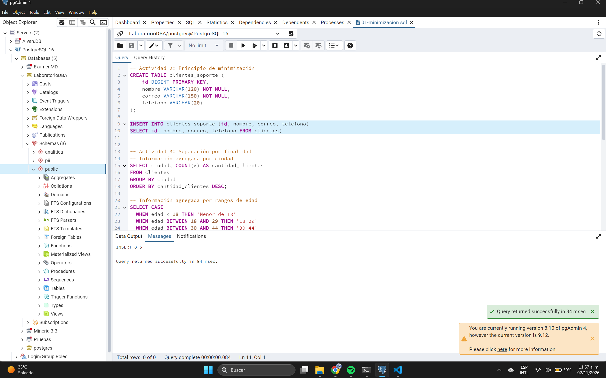
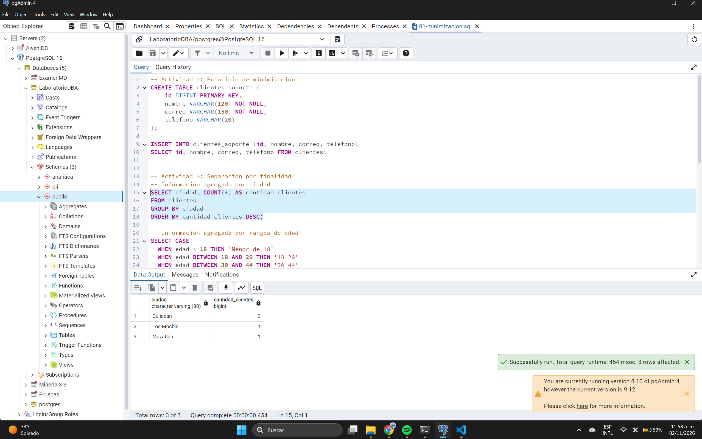
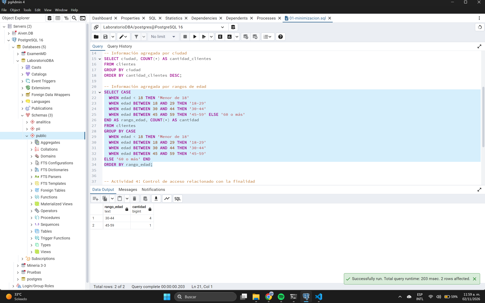
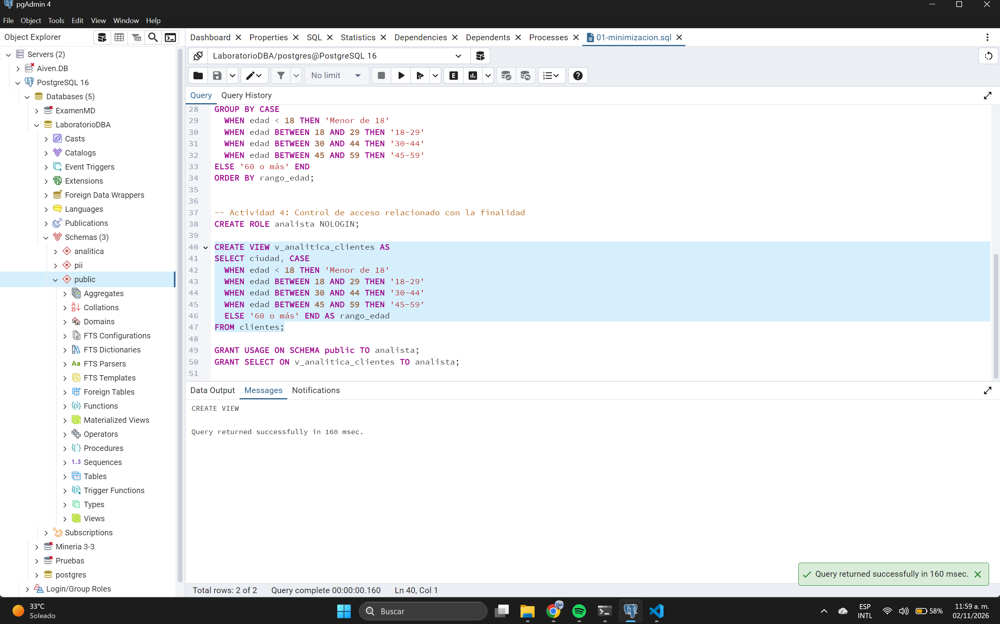
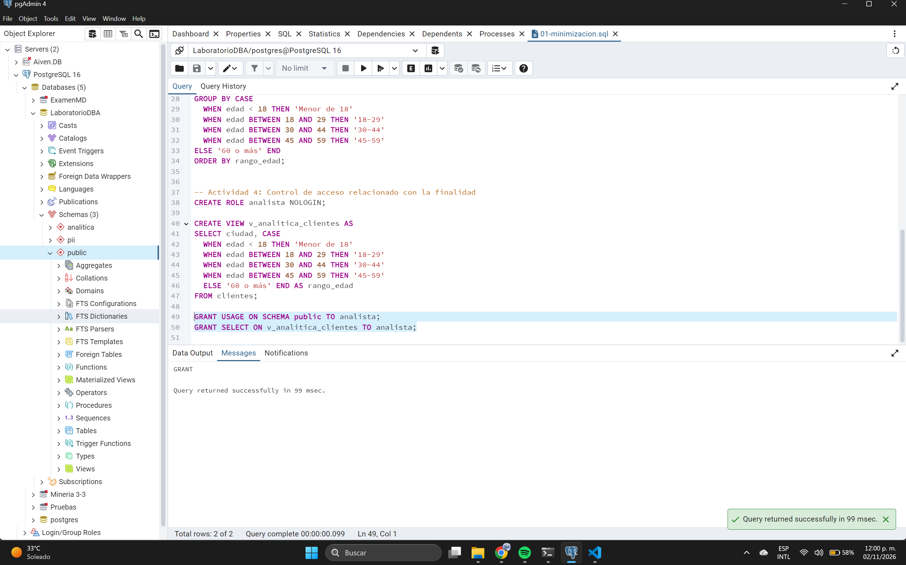
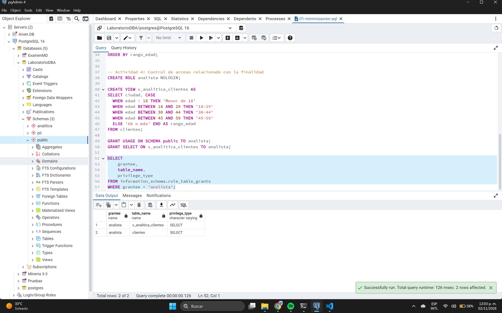

# Actividad 1: Inventario y finalidad de los datos

| Campo | ¿Es personal? | Finalidad | ¿Es necesario? | Nivel de acceso | Retención |
| :--- | :--- | :--- | :--- | :--- | :--- |
| **id** | No | Llave primaria técnica | Sí | DBA/Sistemas | Permanente |
| **nombre** | Sí | Atención, Facturación | Sí | Atención, Facturación | Durante la relación comercial |
| **correo** | Sí | Atención al cliente | Sí | Atención | Durante la relación comercial |
| **telefono** | Sí | Contacto operativo | Sí | Atención | Durante la relación |
| **rfc** | Sí (financiero/fiscal) | Facturación | Solo si factura | Facturación | Determinado por leyes fiscales |
| **edad** | Sí | Analítica | Sí, para estadísticas | Analítica (agregado) | Hasta generar histórico anonimizado |
| **ciudad** | Sí | Analítica, Operación | Sí | Atención, Analítica | Durante la relación |
| **codigo_postal**| Sí | Facturación, Analítica | Sí | Facturación, Analítica | Legal fiscal |
| **fecha_alta** | No (metadato) | Control interno | Sí | Analítica, DBA | Permanente |

---

# Actividad 2: Principio de minimización

**Respuestas a las preguntas:**
1. **¿Todos los campos son necesarios para atención al cliente?** No, atención al cliente no requiere el RFC, la edad o el código postal para brindar soporte general.
2. **¿Por qué soporte necesitaría conocer el RFC?** Soporte técnico no necesita conocer el RFC; su finalidad es resolver problemas operativos, no facturar.
3. **¿Necesita conocer la edad?** No, la edad del cliente no es relevante para otorgar asistencia.
4. **¿Necesita conocer el código postal?** No, a menos que el servicio requiera enviar técnicos a domicilio.
5. **¿Qué principio de privacidad está relacionado con esta decisión?** Se relaciona directamente con el principio de minimización de datos y el de limitación de finalidad.

**Diseñar una estructura mínima (SQL):**
```sql
CREATE TABLE clientes_soporte (
    id BIGINT PRIMARY KEY,
    nombre VARCHAR(120) NOT NULL,
    correo VARCHAR(150) NOT NULL,
    telefono VARCHAR(20)
);
INSERT INTO clientes_soporte (id, nombre, correo, telefono)
SELECT id, nombre, correo, telefono FROM clientes;
```

---

# Actividad 3: Separación por finalidad

**Pregunta:** 
1. **¿Por qué esta información puede ser más apropiada para analítica que entregar directamente la tabla completa de clientes?** Entregar rangos de edad y conteos agrupados (información agregada) previene que los analistas puedan identificar a los individuos, cumpliendo con el principio de minimización de datos y limitando la exposición de datos personales innecesarios para generar métricas.

**Consulta (SQL):**
```sql
-- Información agregada por ciudad
SELECT ciudad, COUNT(*) AS cantidad_clientes FROM clientes GROUP BY ciudad ORDER BY cantidad_clientes DESC;

-- Información agregada por rangos de edad
SELECT CASE
  WHEN edad < 18 THEN 'Menor de 18'
  WHEN edad BETWEEN 18 AND 29 THEN '18-29'
  WHEN edad BETWEEN 30 AND 44 THEN '30-44'
  WHEN edad BETWEEN 45 AND 59 THEN '45-59' ELSE '60 o más'
END AS rango_edad, COUNT(*) AS cantidad FROM clientes
GROUP BY CASE
  WHEN edad < 18 THEN 'Menor de 18'
  WHEN edad BETWEEN 18 AND 29 THEN '18-29'
  WHEN edad BETWEEN 30 AND 44 THEN '30-44'
  WHEN edad BETWEEN 45 AND 59 THEN '45-59'
ELSE '60 o más' END ORDER BY rango_edad;
```

---

# Actividad 4: Control de acceso relacionado con la finalidad

**Respuestas a las preguntas:**
1. **¿Qué información puede consultar el rol?** El rol "analista" únicamente puede consultar las columnas `ciudad` y `rango_edad` a través de la vista `v_analitica_clientes`.
2. **¿Puede consultar directamente clientes?** No, no tiene privilegios sobre la tabla principal `clientes`.
3. **¿Puede obtener nombre, correo y RFC?** No, esos campos no forman parte de la vista ni tienen permiso `SELECT` directo.
4. **¿Qué principio de privacidad estás aplicando?** Principio de limitación de finalidad y minimización de datos.
5. **¿Qué principio de seguridad estás aplicando?** Principio de menor privilegio o necesidad de saber (need-to-know) mediante controles técnicos.

**Control de acceso (SQL):**
```sql
CREATE ROLE analista NOLOGIN;
CREATE VIEW v_analitica_clientes AS 
SELECT ciudad, CASE
  WHEN edad < 18 THEN 'Menor de 18'
  WHEN edad BETWEEN 18 AND 29 THEN '18-29'
  WHEN edad BETWEEN 30 AND 44 THEN '30-44'
  WHEN edad BETWEEN 45 AND 59 THEN '45-59'
  ELSE '60 o más' END AS rango_edad 
FROM clientes;

GRANT USAGE ON SCHEMA public TO analista;
GRANT SELECT ON v_analitica_clientes TO analista;

SELECT 
    grantee, 
    table_name, 
    privilege_type 
FROM information_schema.role_table_grants
WHERE grantee = 'analista';
```

# Evidencias








